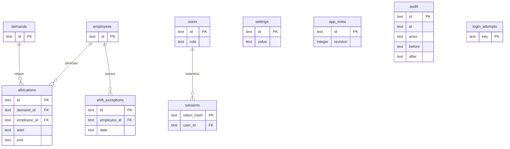

# Capacity Manager — Gestão de Capacidade Operacional

MVP funcional para cadastrar pessoas, demandas e escalas; planejar alocações; calcular capacidade produtiva; validar descanso entre jornadas; simular novas atividades e compartilhar uma visão de leitura com o cliente.

## Executar localmente

O pacote entregue inclui o build pronto. Com **Node.js 24** instalado, extraia o ZIP e execute `Iniciar-Capacity-Manager.cmd`, ou rode `npm start` na pasta extraída. Abra `http://127.0.0.1:5173`. Esse modo não exige baixar dependências, ter conta Cloudflare ou PostgreSQL.

**Para abrir esta instalação atualizada:** feche o terminal que está executando a versão anterior e execute novamente `Iniciar-Capacity-Manager.cmd` nesta mesma pasta. Seus dados continuam em `.data/capacity.sqlite`. Ao atualizar por um ZIP, preserve a pasta `.data` da instalação anterior; o pacote não inclui dados de usuários nem substitui esse banco.

O arquivo `demo/capacity-demo.sqlite` contém o banco demonstrativo para inspeção, com cinco colaboradores e treze demandas, sem usuários nem senhas. O servidor cria seu banco de trabalho independente em `.data/capacity.sqlite`.

Para desenvolver a partir do código-fonte ou reconstruir a aplicação, use Node.js 24, npm e acesso à internet na instalação:

```powershell
cd C:\caminho\capacity-manager
npm ci
npm run setup
npm run dev
```

Abra a URL local exibida pelo servidor, normalmente `http://localhost:5173`. `setup` gera o build e aplica somente as migrações pendentes ao SQLite local. Execute novamente após receber novas migrações. Os dados demonstrativos são inseridos uma única vez no primeiro acesso: cinco colaboradores e treze demandas, relativas à semana atual no fuso configurado. O banco persiste em `.data/capacity.sqlite`; reiniciar o servidor não apaga os registros. O servidor local usa o SQLite do próprio Node.js, sem depender do runtime nativo do Cloudflare.

No primeiro acesso local, a tela **Criar administrador** solicita nome, usuário e senha de pelo menos 12 caracteres. Não existe senha padrão nem entrada automática de administrador. Depois, em **Configurações → Acessos**, crie contas **Administrador** ou **Consulta**. O botão **Sair** revoga a sessão e retorna ao login. O servidor local continua vinculado exclusivamente a `127.0.0.1`.

A configuração inicial aceita converter a antiga conta local sem senha, preservando os dados do MVP anterior. Depois que existe um administrador com senha, essa configuração não pode ser repetida para substituir credenciais. Na hospedagem privada, o acesso também respeita a identidade e as permissões da plataforma Sites.

```powershell
npm test
npm run typecheck
npm run build
```

Para servir o build com o banco existente: `npm start`. O servidor local utiliza a mesma saída compilada da aplicação publicada; execute `npm run build` após alterar a interface ou API e reinicie. `npm run dev:worker` oferece o fluxo Vite com HMR em ambientes compatíveis com Workerd. Nunca exponha o modo de administração local à internet.

## Arquitetura

- **Interface:** React 19, TypeScript, Vinext/Vite, CSS responsivo, ícones Lucide.
- **API REST:** rotas TypeScript executadas no servidor, controle de perfis e validação Zod.
- **Persistência:** SQLite nativo do Node.js localmente e Cloudflare D1 em produção, com modelo relacional, chaves estrangeiras, índices e migrações Drizzle.
- **Motor:** módulo puro `lib/engine.ts`, compartilhado pela interface e API. A validação no servidor é obrigatória antes de persistir.
- **Datas:** instantes ISO com offset explícito, APIs IANA de `Intl` para conversão de fusos e datas civis para recorrências. Padrão `America/Sao_Paulo`. A data de início da escala determina a semana de uma ativação.

Foi adotado um servidor TypeScript integrado, em lugar da sugestão FastAPI, para executar a mesma aplicação localmente e no Sites com persistência real. PostgreSQL não está incluído nesta versão; a camada de persistência está concentrada em `lib/store.ts` e o modelo relacional permite um adaptador futuro.

```text
app/page.tsx                  Aplicação e navegação
components/capacity/forms.tsx Cadastros e configurações
app/api/                     Autenticação, leitura, mutação, simulação e exportação
lib/types.ts                 Contratos do domínio
lib/time.ts                  Datas civis, fusos e intervalos
lib/engine.ts                Capacidade, calendário, descanso e validação
lib/store.ts                 Persistência, revisão e auditoria
lib/auth.ts                  Perfis, usuários, senhas e sessões
lib/seed.ts                  Dados demonstrativos
lib/reports.ts               Relatórios Excel e PDF
scripts/server.mjs           Servidor local Node.js
scripts/sqlite-d1.mjs        Adaptador SQLite e migrações locais
db/schema.ts                 Modelo relacional
drizzle/                     Migrações versionadas
tests/                       Testes do motor e integração SQLite/API
```

## Fluxo de uso

1. Cadastre ou edite pessoas em **Colaboradores**, incluindo jornada, dias, pausas, limites e elegibilidade.
2. Em **Escalas**, cadastre exceções por data: ajustes, folgas, ausências, férias, feriados ou atuação extraordinária. Apenas escalas aprovadas integram a capacidade confirmada.
3. Cadastre uma demanda e adicione uma ou várias alocações. Cada pessoa pode ter seu próprio início e término dentro da demanda. Use **Confirmar alocação** para comprometer as horas, após validar cobertura completa, jornadas e demais regras. **Salvar reserva** mantém a demanda em planejamento e mostra suas horas separadamente.
4. Consulte o **Calendário operacional**, com 24 horas, visão de dia/semana/mês e detalhes ao passar o cursor. Clique numa faixa para iniciar um cadastro ou editar uma demanda existente.
5. Use os filtros e o período para avaliar projeções. O simulador permite consultar elegíveis e alternativas sem gravar alterações. Confirmar uma simulação abre um cadastro revisável, sujeito novamente à validação do servidor.
6. Crie um acesso **Consulta**. Esse perfil vê somente **Visão geral** e **Calendário operacional**, incluindo as demandas confirmadas e seus horários, sem editar dados ou acessar outros módulos.

## Acompanhamento de horas e visões do dashboard

Uma demanda confirmada de duas horas com duas pessoas acrescenta quatro horas às **comprometidas** e reduz em quatro horas a **capacidade livre**. A confirmação, alteração, remoção ou cancelamento atualiza os indicadores usando o estado devolvido pela API. O total de capacidade confirmada continua representando as escalas produtivas aprovadas.

Uma reserva ainda não confirmada aparece nas horas de planejamento e na fila de confirmação. As horas alocadas são apresentadas junto das horas produtivas cobertas: um período fora da jornada pode ser planejado, mas não pode consumir capacidade oficial nem ser confirmado sem ajustar a escala. O formulário informa os bloqueios da tentativa de confirmação; não aprova automaticamente uma demanda apenas por adicionar uma pessoa.

A **Visão gerencial** apresenta o andamento operacional, distribuição do trabalho, reservas e pendências de confirmação. A **Visão executiva** apresenta a capacidade residual, janelas disponíveis e riscos de atendimento. Ambas utilizam o mesmo período, filtros e regras de capacidade.

## Equipe cadastrada e identidade visual

| Profissional | Papel | Jornada padrão | Intervalo |
|---|---|---|---|
| Lucas Cordeiro | Analista | 23h–05h do dia seguinte | Sem pausa dentro desta janela |
| Marcelo | Analista | 09h–18h | 12h–13h |
| Lizzie | Analista | 09h–18h | 12h–13h |
| Lucas Telesi | Analista | 09h–18h | 12h–13h |
| Tatiane Ramos | Ponto focal | 09h–18h | 12h–13h |

Foi mantida a premissa configurável de segunda a sexta. Conforme a definição operacional atualizada, Lucas Cordeiro trabalha das 23h às 05h, com 30h regulares semanais; os quatro diurnos têm 40h produtivas semanais. O limite semanal inicial de 48h foi preservado. A antiga pausa de Lucas, 22h–23h, foi preservada no cadastro existente, mas fica antes do início da nova jornada e não reduz as seis horas produtivas. Nomes, funções, horários e pausas podem ser editados pelo administrador.

O visual utiliza a paleta publicada no [site da Spread](https://spread.com.br/): roxo `#4B1196`, roxo vibrante `#7F3DFF`, roxo escuro `#11061E` e laranja `#FF7400`. O logotipo e as fontes Outfit/DM Sans são servidos localmente; as licenças das fontes estão em `public/fonts`.

## Filtro de tipo e capacidade CHG

Em **Visão geral** e **Calendário operacional**, o filtro **Tipo de demanda** fica visível. Selecionar CHG restringe a capacidade à interseção entre a jornada produtiva e a janela CHG configurada. Horas diurnas livres não viram capacidade de CHG. Demandas confirmadas de qualquer tipo continuam consumindo a mesma capacidade, mesmo quando ocultadas pelo filtro de tipo.

Na jornada atualizada de Lucas Cordeiro, a capacidade regular de CHG é de **23h a 05h**, seis horas em cada uma das cinco noites de segunda a sexta: **30 pessoa-horas regulares por semana**. Cada um dos quatro diurnos elegíveis possui uma cota de uma janela extraordinária semanal de seis horas: **24h de cota extraordinária**. O painel semanal apresenta **54h de capacidade planejável**, com a composição 30h + 24h e o saldo após os compromissos da semana.

Essa cota é um orçamento semanal, sem data atribuída. A capacidade com datas aprovadas e as horas livres oficiais permanecem separadas: antes de programar extras, são 30h regulares. Aprovar uma extra completa aumenta a capacidade datada para 36h e consome 6h da cota, restando 18h para novas ativações; o total semanal continua 54h. Várias demandas na mesma noite não consomem novas ativações. Uma ativação parcial também utiliza uma das noites permitidas; suas horas produtivas reais continuam sendo calculadas pelo intervalo aprovado.

O orçamento depende dos colaboradores ativos, da elegibilidade, dos limites e da janela noturna configurada; não existe um valor fixo de 54h no código. O calendário diário mostra apenas horas reais naquela data e não repete as 24h de cota em cada dia. O resumo semanal considera semanas completas e identifica o período correspondente, inclusive quando o filtro seleciona um único dia. Uma escala que começa no domingo e termina na segunda consome a cota e os compromissos da semana de início. A madrugada continua aparecendo na data civil correta no calendário.

O resumo mostra capacidade confirmada, comprometida, livre e potencial separadamente. A tabela diária lista as demandas confirmadas com código, descrição, horários e pessoas alocadas; períodos sem capacidade permanecem visíveis. Quando outro tipo de demanda ocupa a janela do tipo selecionado, ele aparece em **Outras demandas que ocupam esta janela**. Uma janela livre indica disponibilidade positiva, sem garantir atendimento de qualquer duração ou quantidade de pessoas. O administrador usa o simulador para validar uma demanda concreta.

## Premissas operacionais configuráveis

- Quatro jornadas diurnas, segunda a sexta, 09h–18h, pausa 12h–13h. Lucas Cordeiro tem jornada fixa 23h–05h, com seis horas produtivas. A escala ancorada na sexta-feira se estende até sábado às 05h; não há escala fixa **iniciada** no sábado/domingo por padrão.
- CHGs precisam caber integralmente na janela noturna configurada (inicial 23h–05h), inclusive após meia-noite.
- Semana inicial segunda–domingo. Uma ativação iniciada domingo pertence à semana do domingo. Várias demandas na mesma escala e data de início contam como uma ativação por pessoa.
- Descanso inicial de 11 horas. Para atuar às 23h, o diurno deve ter terminado a jornada anterior até 12h; é necessário cadastrar um ajuste prévio. O sistema não aprova a noite se a jornada anterior termina às 18h.
- Após uma escala noturna que termina às 05h, a capacidade da jornada regular seguinte começa às 16h. A pausa continua excluída, sem dupla contagem. Uma alocação já confirmada antes do retorno impede a aprovação da nova escala.
- Para programar uma extra, cadastre e aprove sua data em **Escalas**. Se houver jornada diurna no dia em que a CHG começa às 23h, ajuste-a para terminar até 12h antes de aprovar a noite. O retorno seguinte é calculado automaticamente às 16h, mantendo trabalho produtivo de 16h a 18h na jornada diurna padrão. O sistema não ajusta nem remove compromissos existentes silenciosamente.
- A capacidade produtiva considera a união dos intervalos por pessoa, subtraindo pausas, ausências e descanso. Duas pessoas por três horas consomem seis pessoa-horas.
- Excluir uma CHG libera suas alocações. **Uma escala extraordinária explicitamente aprovada continua existindo**, assim como o descanso associado à jornada. Para cancelar também a atuação, remova ou remaneje a escala em **Escalas**. O descanso é sempre recalculado; não fica salvo como bloqueio órfão.
- Capacidade potencial nunca integra automaticamente a confirmada. O potencial soma no máximo as ativações ainda permitidas na semana, sem somar todas as noites alternativas como se pudessem ser utilizadas juntas. Uma ativação pode reduzir a capacidade da jornada seguinte; o simulador informa esse impacto.
- A métrica **déficit** inclui pessoa-horas de demandas pendentes sem cobertura produtiva no período. Reservas têm métrica própria e não consomem capacidade comprometida.
- Limites iniciais de ocupação: confortável abaixo de 85%; atenção de 85% a 100%; insuficiente acima de 100%. Déficit previsto também sinaliza risco, mesmo com horas livres em outros horários.
- Ausências são cadastradas por data civil; férias ou feriados de vários dias exigem registros por data nesta versão. Ajustes substituem a jornada recorrente com aquela data de início. Pausas fora do horário ajustado não retiram horas adicionais.
- Não há tolerância automática para violações. Para remanejar uma escala com compromissos, primeiro mova ou passe as demandas afetadas a planejamento, ajuste as escalas e depois confirme novamente.

## Perfis e segurança

| Ação | Administrador | Consulta |
|---|---|---|
| Visão geral e calendário operacional | Sim | Sim |
| Ver demandas confirmadas e alocações | Sim | Sim, em leitura |
| Cadastros, escalas, simulador e exportações | Sim | Não |
| Configurações e gestão de acessos | Sim | Não |

O perfil Consulta é armazenado internamente como `client`, mantendo compatibilidade com a primeira versão. O antigo perfil `manager`, se existir, não ganha privilégios automaticamente e não é oferecido na criação de novos acessos. O servidor bloqueia as operações restritas; esconder botões não é a camada de segurança. Auditoria, credenciais, solicitantes e observações internas não são enviados à consulta. Demandas pendentes podem compor a previsão com descrição mascarada. Senhas usam PBKDF2-SHA256 com salt aleatório; sessões usam cookies HttpOnly, SameSite e Secure em HTTPS, com validade de oito horas. Tentativas de login são limitadas. Gravações verificam a origem e a revisão do planejamento; uma revisão obsoleta retorna HTTP 409. SQL em lote aplica dados e auditoria atomicamente.

## API

| Método / rota | Uso |
|---|---|
| `GET /api/state` | `{state,session}` com redação conforme perfil |
| `GET /api/session` | Perfil autenticado |
| `GET /api/setup` | Estado da configuração inicial |
| `POST /api/setup` | Cria o primeiro administrador em contexto autorizado |
| `POST /api/auth` | `{username,password}`; cria cookie |
| `DELETE /api/auth` | Revoga cookie/sessão |
| `GET /api/users` | Lista acessos para administrador |
| `POST /api/mutate` | `{entity,action,data,revision}` |
| `POST /api/simulate` | `{type,start,end,required}`; sem gravação |
| `GET /api/export?format=xlsx&from=AAAA-MM-DD&to=AAAA-MM-DD` | Excel real, múltiplas abas |
| `GET /api/export?format=pdf&from=AAAA-MM-DD&to=AAAA-MM-DD` | PDF paginado |

Entidades: `employee`, `demand`, `exception`, `settings`, `user`. Ações: `upsert` e `delete`; configurações não podem ser removidas, contas devem ser inativadas. Erros de validação retornam motivos legíveis em `issues`. A API revalida os compromissos existentes também ao alterar pessoas, regras ou escalas.

## Modelo relacional



`weekdays` e `breaks` são estruturas JSON do cadastro da pessoa; dados operacionais e vínculos são relacionais. Histórico inclui os estados anterior e posterior das alterações, sem senhas. A interface apresenta os últimos 300 registros; os registros completos permanecem no banco.

## Evoluções previstas

Integração com identidade corporativa, importação em lote de feriados/férias, controle de aprovação em múltiplas etapas, notificações, adaptador PostgreSQL e integração com sistemas de chamados. O MVP usa seleção de faixa horária seguida de formulário; não implementa arraste de blocos ou atualização por WebSocket.

